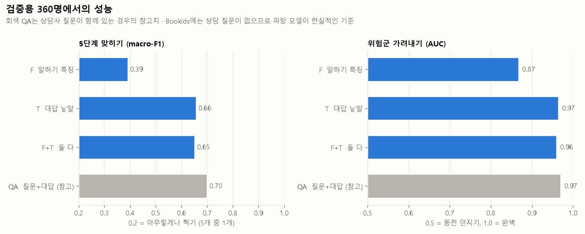
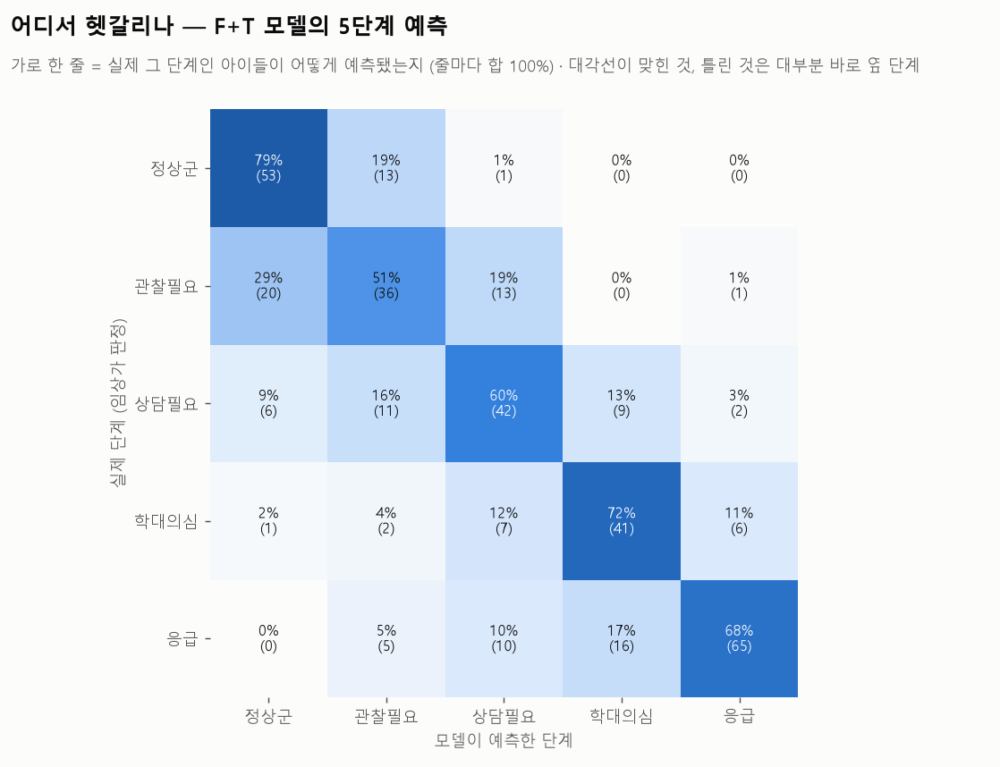
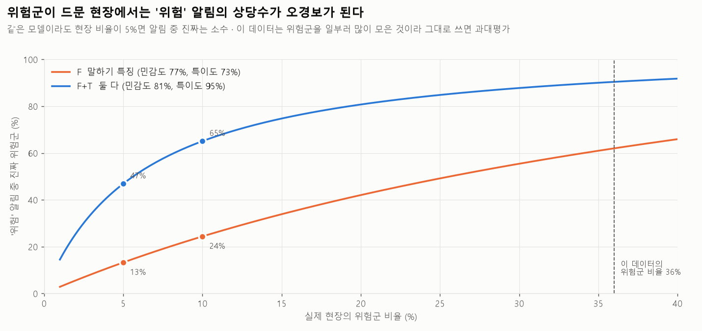
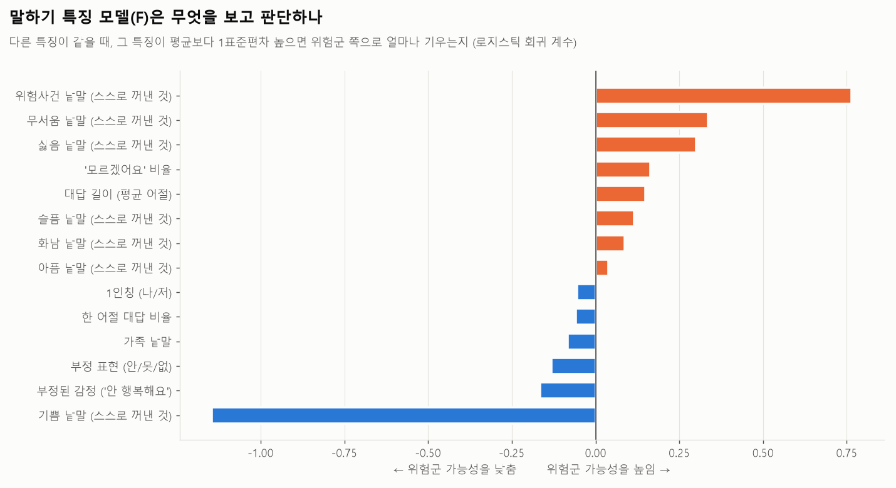

# 4단계 결과: 위기단계 예측 기본 모델

수치: [`model.md`](model.md) · 코드: [`model.py`](../scripts/model.py), [`viz_model.py`](../scripts/viz_model.py), [`probe_story.py`](../scripts/probe_story.py)

## 한 줄 요약
상담 문답 안에서는 위험군을 잘 가려내지만(AUC 0.96), 그 성능은 대부분 학대 질문에 대한 **직접적인 고백**에서 나온다. 그대로 그림책 이야기에 쓰면 "늑대가 토끼를 때렸어요"에도 위험 알림이 뜬다.

## 1. 모델 비교

| 모델 | 입력 | 5단계 macro-F1 | 위험군 AUC |
|---|---|---|---|
| F | 말하기 특징 14개 | 0.39 | 0.87 |
| T | 아이 대답 낱말 | 0.66 | 0.97 |
| F+T | 둘 다 | 0.65 | 0.96 |
| QA | 질문 + 대답 (참고) | 0.70 | 0.97 |

- 상담 질문을 빼도(T) 성능이 거의 그대로다(QA 0.97 → T 0.97). 아이 대답 자체에 정보가 많다.
- F에 T를 더해도 나아지지 않는다. T가 F의 정보를 이미 담고 있다.

## 2. 어디서 헷갈리나

- 틀린 것은 대부분 **바로 옆 단계**다(관찰필요↔정상군, 학대의심↔응급). 정상군을 응급으로 보는 큰 실수는 0건.
- 관찰필요가 가장 어렵다(51%).

## 3. 현장 비율에 따른 정밀도

- 이 데이터는 위험군이 36%로 맞춰져 있다. 실제 유치원은 훨씬 적다.
- 현장 위험군이 5%라면, F+T의 '위험' 알림 중 진짜는 47%, F는 13%뿐이다.

## 4. 모델이 무엇을 보나

### F 모델 (말하기 특징)

- 위험사건 낱말과 무서움 낱말이 많을수록 위험군 쪽으로 기운다.
- 기쁨 낱말이 많을수록 정상군 쪽으로 기우며, 계수 중 가장 크다.

### T 모델 (대답 낱말): 위험군 쪽 상위 낱말
`때리` `만지` `죽` `맞` `술` `괴롭히` `욕` `뺨` `가슴` `아저씨` `매일` `떠오르`

- 대부분 "때린 적 있니?", "만진 적 있니?"라는 **학대 문항에 대한 고백**이다.
- 정상 쪽 낱말은 `행복` `엄마` `공부` `재밌` `기분 좋` 등이다.

## 5. 그림책 이야기 오경보 점검
상담 데이터가 아닌, 그림책 이야기처럼 만든 문장을 T 모델에 넣어 보았다(기준점 0.59).

| 입력 | 위험확률 | 결과 |
|---|---|---|
| 평범한 이야기 (토끼가 놀러 갔어요…) | 0.05 | - |
| 이야기 속 갈등 (늑대가 토끼를 때렸어요…) | 0.69 | **위험 알림 (오경보)** |
| 공룡 싸움 이야기 (공룡이 죽었어요…) | 0.25 | - |
| 아이 본인 고백 (아빠가 술 마시고 나를 때렸어요…) | 0.97 | 위험 알림 |

모델은 **누가 누구에게** 한 일인지 구분하지 못한다. 늑대가 토끼를 때린 것과 아빠가 나를 때린 것을 같은 낱말로 본다.

## 6. 결론과 다음 단계 제안
T·F+T 모델은 Bookids에 그대로 쓰지 않는다. 대신 두 갈래로 나눈다.

1. **고백 감지 (안전 경로)**
   - 주어나 대상이 **아이 자신(나·저)이거나 실제 가족·어른(아빠·엄마·선생님·아저씨)**인 해(害) 문장만 골라낸다.
   - 고른 문장은 점수에 섞지 않고 교사에게 바로 알린다. 원장·전문가 확인으로 이어지는 경로다.
   - 이야기 등장인물(늑대·토끼·공룡)의 사건은 제외한다.
2. **감정 흐름 (대시보드)**
   - F처럼 해석 가능한 특징만 쓴다.
   - 다른 아이와 비교하지 않고 **그 아이의 평소 수준과 비교**한다. 예: "지난달 1번 → 이번 주 6번". 교사 대시보드 설계와 같은 방식이다.

두 갈래 모두 실제 Bookids 사용 데이터가 생기면 다시 검증해야 한다.
