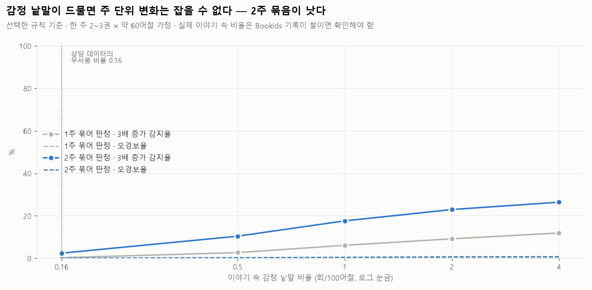
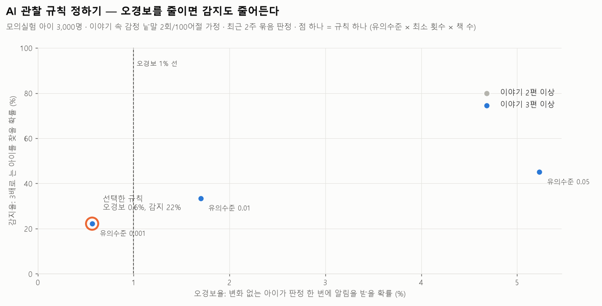
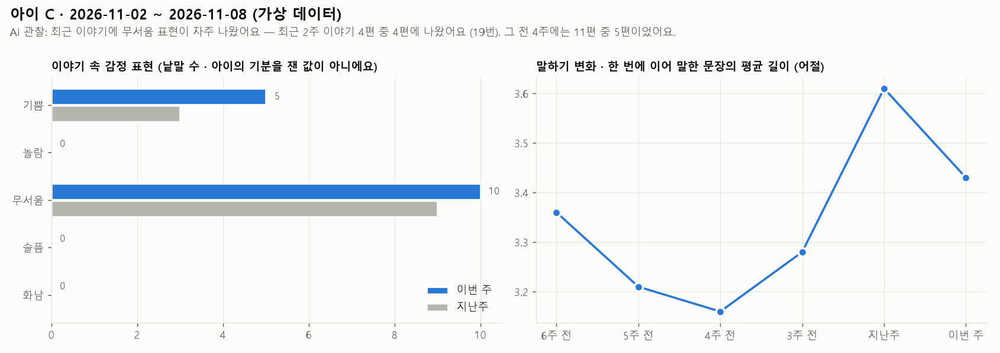

# 6단계: 감정 흐름 (대시보드)

코드: [`story_metrics.py`](../scripts/story_metrics.py) (분석 모듈) · [`calibrate_alerts.py`](../scripts/calibrate_alerts.py) (기준값 모의실험) · [`demo_class.py`](../scripts/demo_class.py) (가상 반 시연)
웹 담당용 명세: [`dashboard_spec.md`](dashboard_spec.md) · 예시 데이터: [`outputs/dashboard_week.json`](../outputs/dashboard_week.json)

## 만든 것
Bookids 발화 기록을 넣으면 교사 대시보드(화면 8)의 숫자가 모두 나오는 분석 모듈이다.
- **카드 4개**: 만든 장면, 스스로 이어 말한 장면, 평균 문장 길이, 처음 쓴 낱말
- **그래프**: 이야기 속 감정 표현(이번 주 / 지난주), 말하기 변화(6주)
- **AI 관찰 메모**: 근거 문장 2개 포함
- **자주 나온 인물·주제**
- **safety**: 5단계 고백 감지 결과

## 핵심 발견: 주 단위 감정 변화는 생각보다 잡기 어렵다

### 1. 상담 데이터 비율로는 불가능하다

- 상담 데이터에서 아이가 스스로 꺼낸 무서움 낱말은 100어절당 0.16회다.
- 한 주에 이야기 2~3권(약 150어절)이면 기대값이 0.24회다. 3배로 늘어도 1회가 안 되어, 어떤 규칙으로도 거의 못 잡는다(감지 4~5%).
- 이야기 속 감정 낱말 비율이 높을수록(감정이 많이 나오는 이야기일수록) 감지율이 오른다. 실제 비율은 Bookids 기록으로 확인해야 한다.

### 2. 무서운 이야기 한 편 때문에 울리면 안 된다
- 처음 만든 단순 검정(포아송)은 비율이 높아질수록 오경보가 5~11%까지 올랐다. 그날 지은 이야기 한 편이 무서웠을 뿐인 아이에게 알림이 간 것이다.
- 그래서 **이야기마다 분위기가 다른 것을 반영한 검정**(음이항)으로 바꿨다.
- 또 **2권 이상의 이야기에 걸쳐 나와야** 알림을 낸다.

### 3. 규칙 선택: 오경보를 줄이는 쪽

- 이야기 속 감정 비율을 2회/100어절로 가정하면, 유의수준만으로 오경보와 감지가 맞바뀐다.
- **유의수준 0.001**로 정했다. 오경보 0.6%(18명 반이면 2~3주에 한 번 정도), 3배 증가 감지 25%, 5배 증가 감지 53%다.
- 그래서 AI 관찰은 **강하고 지속적인 변화만** 알려 준다. 교사 관찰을 대신하지 않는 보조 신호다.

## 가상 반 시연 (18명 × 6주, 발화 2,078개, 실제 아이 말 아님)

| 상황 | 기대 | 결과 |
|---|---|---|
| 아이 C: 최근 2주, 여러 이야기에 '혼자'·'무서움'이 늘어남 | AI 관찰 | ✔ "최근 2주 동안 12번, 그 전 4주 동안 1번" · 근거 문장 2개 · 주제 '혼자 ↑' |
| 아이 F: 마지막 주 괴물 이야기 한 권만 무서움 | 알림 없음 | ✔ 없음 |
| 아이 H: "아빠가 어제 나를 때렸어요" | safety 알림 | ✔ 알림 (신체 폭력) |
| 나머지 15명 | 없음 | ✔ 없음 |

## 앱 설계에 대한 제안
1. **AI 질문에 가끔 기분을 묻는 질문을 넣는다.** 예: "토끼는 그때 기분이 어땠을까?"
   - 감정 낱말을 직접 말해 주지 않는 질문이라, 아이의 대답은 '스스로 꺼낸 감정'으로 셀 수 있다.
   - 감정 데이터가 늘어 감지율이 오른다. 단 "무서웠어?"처럼 감정을 제시하면 따라 말한 것이 되므로 피한다.
2. `prompt`(AI 질문)를 발화와 함께 저장한다. 질문을 따라 말한 감정을 걸러내는 데 필요하다.
3. 교사의 버튼 선택(숨기기, 이야기 속 내용이에요 등)을 저장한다. 규칙을 고치는 데 쓴다.

## 한계와 다시 할 일
- 기준값은 모두 **가정에 기반한 모의실험**이다. 이야기 속 감정 비율, 이야기마다 분위기 차이 정도, 주당 이야기 수가 그 가정이다. Bookids 기록이 4~6주 쌓이면 `calibrate_alerts.py`의 가정을 실제 값으로 바꿔 다시 돌린다.
- '기쁨이 줄어드는 것'은 4단계에서 가장 강한 신호였지만, 줄어듦은 늘어남보다 잡기 어려워 아직 관찰 대상에 넣지 않았다.
- '주제 ↑'는 가상 데이터에서도 우연히 뜨는 낱말(그림·나무)이 있다. 실제 데이터로 기준을 다시 정해야 한다.
